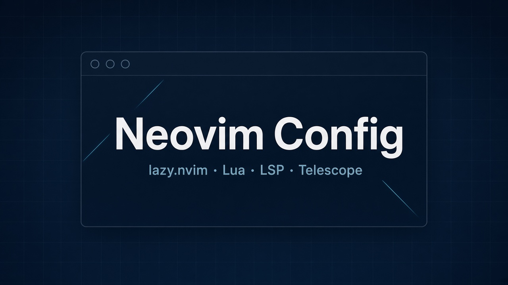
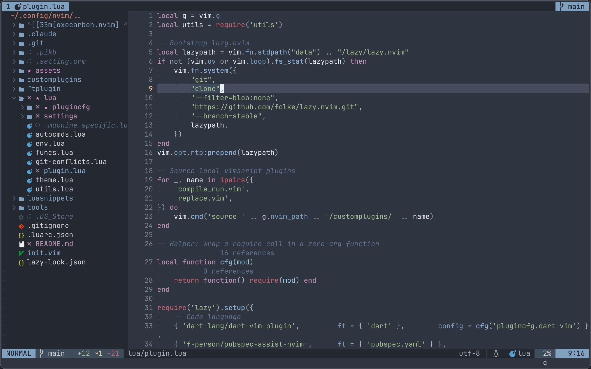

<div align="center">



# Neovim Config

Personal Neovim setup built on **lazy.nvim** + **Lua**

macOS / Linux first-class · Windows partial

<br />

[](https://neovim.io)
[](https://www.lua.org)
[](https://github.com/folke/lazy.nvim)
[](#license)

`treesitter` · `LSP` · `Telescope` · `Flutter` · `nordfox`

<br />



<sup>Live screenshot · <code>nordfox</code> · nvim-tree · lualine</sup>

</div>

---

## Quick start

```bash
# clone into config dir
git clone https://github.com/zlj-zz/nvim.git ~/.config/nvim

# system deps (macOS)
brew install ripgrep gopls ctags node python3
pip3 install pynvim && npm install -g neovim

# optional: Nerd Font + input-method switcher
brew install --cask font-hack-nerd-font
brew tap daipeihust/tap && brew install im-select
```

Open Neovim once → `:Lazy sync` → `:checkhealth`.

---

## Layout

```text
~/.config/nvim
├── init.lua                 entry → env / settings / plugins / autocmds
├── lua/
│   ├── plugin.lua           lazy.nvim specs
│   ├── theme.lua            colorscheme cycle + persistence
│   ├── settings/            options · mappings
│   ├── plugincfg/           one file per plugin
│   ├── funcs.lua            helpers (smart close, splits, …)
│   └── utils.lua            map / opt wrappers
└── ftplugin/                filetype locals (markdown snippets, …)
```

Source of truth for keys and plugins: `lua/settings/mappings.lua` and `lua/plugin.lua`.

---

## Stack

### Core

| Plugin | Role |
|--------|------|
| [lazy.nvim](https://github.com/folke/lazy.nvim) | Plugin manager |
| [nvim-treesitter](https://github.com/nvim-treesitter/nvim-treesitter) (+ textobjects) | Highlight · fold · motions |
| [nvim-lspconfig](https://github.com/neovim/nvim-lspconfig) | LSP client configs |
| [nvim-cmp](https://github.com/hrsh7th/nvim-cmp) + LuaSnip | Completion · snippets |
| [conform.nvim](https://github.com/stevearc/conform.nvim) | Formatting |

### Navigation & UI

| Plugin | Role |
|--------|------|
| [Telescope](https://github.com/nvim-telescope/telescope.nvim) (+ fzf-native) | Fuzzy find / grep |
| [nvim-tree](https://github.com/nvim-tree/nvim-tree.lua) | File explorer |
| [aerial.nvim](https://github.com/stevearc/aerial.nvim) | Code outline |
| [trouble.nvim](https://github.com/folke/trouble.nvim) | Diagnostics panel |
| [lualine](https://github.com/nvim-lualine/lualine.nvim) | Statusline · buffers |
| [dashboard-nvim](https://github.com/nvimdev/dashboard-nvim) | Start screen |
| [toggleterm](https://github.com/akinsho/toggleterm.nvim) | Integrated terminal |
| [undotree](https://github.com/mbbill/undotree) | Undo history |

### Edit polish

| Plugin | Role |
|--------|------|
| [nvim-hlslens](https://github.com/kevinhwang91/nvim-hlslens) | Search match counts |
| [tiny-glimmer](https://github.com/rachartier/tiny-glimmer.nvim) | Undo / redo flash |
| [yanky.nvim](https://github.com/gbprod/yanky.nvim) | Yank history |
| [Comment.nvim](https://github.com/numToStr/Comment.nvim) | Toggle comments |
| [nvim-autopairs](https://github.com/windwp/nvim-autopairs) | Auto pairs |
| [indent-blankline](https://github.com/lukas-reineke/indent-blankline.nvim) | Indent guides |
| [vim-easy-align](https://github.com/junegunn/vim-easy-align) | Align (`ga`) |
| [vim-visual-multi](https://github.com/mg979/vim-visual-multi) | Multi-cursor |
| [splitjoin.vim](https://github.com/AndrewRadev/splitjoin.vim) | Split / join |

### Git · language · AI

| Plugin | Role |
|--------|------|
| [gitsigns](https://github.com/lewis6991/gitsigns.nvim) | Hunks · blame · stage |
| [pigit.nvim](https://github.com/zlj-zz/pigit.nvim) | Git UI (local) |
| [flutter-tools](https://github.com/akinsho/flutter-tools.nvim) | Flutter run / hot reload / Dart LSP |
| [dart-vim-plugin](https://github.com/dart-lang/dart-vim-plugin) | Dart filetype · `dartfmt` on save |
| [pubspec-assist](https://github.com/f-person/pubspec-assist-nvim) | `pubspec.yaml` helpers |
| [render-markdown](https://github.com/MeanderingProgrammer/render-markdown.nvim) | In-buffer markdown |
| [supermaven-nvim](https://github.com/supermaven-inc/supermaven-nvim) | AI inline completion |
| [loom.nvim](https://github.com/zlj-zz/loom.nvim) | Session / workspace snaps (local) |

### Themes

Cycle with `<leader>tc` (persisted). Default: **nordfox**.

`nordfox` · `nightfox` · `carbonfox` · `lackluster` · `lackluster-hack` · `lackluster-mint` · `oxocarbon` · `evergarden` · `silentium`

---

## Keymaps

`<leader>` = `Space`.

### Basics

| Key | Action |
|-----|--------|
| `S` | Save |
| `Q` | Smart close |
| `<C-q>` | Quit all |
| `K` `J` `H` `L` | Move ×5 |
| `<` `>` | Indent (visual keeps selection) |

### Windows · tabs · buffers

| Key | Action |
|-----|--------|
| `sk` `sj` `sh` `sl` | Split (up / down / left / right) |
| `th` `tj` `tk` `tl` | Focus window |
| `tn` · `t-` · `t=` | New tab · prev · next |
| `<M-1>`…`<M-9>` | Jump to tab |
| `b-` `b=` `b#` · `b1`…`b9` | Buffer prev / next / alt / by index |
| `tt` | Toggle nvim-tree |
| `ti` | Aerial outline |
| `tu` | Undotree |

### Telescope · Git · search

| Key | Action |
|-----|--------|
| `,f` `,g` `,b` `,h` | Files · live grep · buffers · recent |
| `,l` `,c` `,k` | Buffer fuzzy · cmd history · keymaps |
| `,pp` `,ps` `,pg` | Pigit entrée · status · term |
| `[h` `]h` | Prev / next hunk |
| `<leader>hp` `hb` `hs` `hr` `hd` | Preview · blame · stage · reset · diff |
| `<leader>fc` | Git conflict picker |
| `<leader>sr` | Substitute (`:%s` / visual `:s`) |

### LSP · diagnostics · format

| Key | Action |
|-----|--------|
| `gd` `gr` `gi` `gy` `gh` | Definition · refs · impl · type · hover |
| `<leader>rn` `<leader>a` | Rename · code action |
| `<leader>cl` | Code lens |
| `gl` · `[d` `]d` | Float diagnostic · prev / next |
| `<leader>xx` | Trouble diagnostics |
| `<leader>cf` | Format (conform) · `:FormatToggle` for format-on-save |

### Terminal · AI · misc

| Key | Action |
|-----|--------|
| `<C-t>` / `<C-l>` | Toggleterm bottom / right |
| `<Esc><Esc>` | Terminal → normal |
| `<C-l>` / `<C-j>` | Supermaven accept / accept word |
| `<leader>mr` | Toggle markdown render |
| `<leader>tc` | Cycle theme |
| `<leader>ls`… | Loom save / load / workspace… |
| `<space>y` | Yank history (Telescope) |
| `<leader>nm` | Neominimap toggle |
| `<F4>` | Toggle transparent background |

Markdown insert snippets (`,b` bold, `,c` code fence, `,a` link, …) live in `ftplugin/markdown.vim`. Jump placeholder: `<leader><leader>` → next `<++>`.

---

## LSP setup

Servers are enabled in `lua/plugincfg/lsp.lua`. Install the binaries yourself:

| Language | Server / notes |
|----------|----------------|
| Go | `gopls` |
| Python | `basedpyright` |
| TypeScript | `vtsls` |
| Lua | `lua_ls` |
| Rust | `rust_analyzer` (via rustup) |
| Bash | `bashls` |
| HTML / CSS / JSON | `html` · `cssls` · `jsonls` |
| YAML | `yamlls` |
| Swift | `sourcekit` (Xcode CLI) |
| Dart / Flutter | [flutter-tools](https://github.com/akinsho/flutter-tools.nvim) (see below) |

Formatters used by conform (when available): `stylua` · `black` · `prettier` · `shfmt` · `gofumpt` / `goimports`.

---

## Flutter / Dart

Requires the [Flutter SDK](https://docs.flutter.dev/get-started/install) on `PATH` (`flutter` · `dart`). Open a `.dart` buffer to load the stack (`ft = dart`).

### What’s enabled

| Feature | Detail |
|---------|--------|
| Dart LSP | Via flutter-tools · same keys as above (`gd` `gh` `<leader>rn` …) |
| Format on save | LSP format + `dart_format_on_save` (line length 100) |
| Widget guides | Vertical guides for widget tree |
| Closing tags | Virtual `// WidgetName` after closing `)` |
| Statusline | App version · device · project config (lualine decorations) |
| Dev log | Opens in a new tab |
| Document color | Swatch via `vim.lsp.document_color` (Neovim 0.12+) |
| Outline | Prefer Aerial (`ti`); `:FlutterOutlineToggle` still available |

FVM is **off** (`fvm = false`). Debugger integration is **off**.

### Commands

No custom `<leader>f*` maps — use commands (or `:FlutterCommands` picker):

| Command | Action |
|---------|--------|
| `:FlutterCommands` | Command palette |
| `:FlutterRun` | Run app |
| `:FlutterReload` | Hot reload |
| `:FlutterRestart` | Hot restart |
| `:FlutterQuit` | Stop app |
| `:FlutterDevices` | Pick device |
| `:FlutterEmulators` | List emulators |
| `:FlutterDevTools` | Start DevTools |
| `:FlutterPubGet` / `:FlutterPubUpgrade` | Pub |
| `:FlutterLogToggle` / `:FlutterLogClear` | Dev log |
| `:FlutterLspRestart` | Restart Dart analysis server |
| `:FlutterRename` | Project-aware rename |

Also: `:FlutterAttach` · `:FlutterDetach` · `:FlutterCopyProfilerUrl` · `:FlutterOpenDevTools` · `:FlutterInspectWidget`.

> Note: `<leader>fc` is the **git conflict** picker, not Flutter.

---

## Notes

- **Input method** — macOS only; switches to ABC on `InsertLeave` when `im-select` is installed. Missing binary → silent no-op.
- **Supermaven** — first run: `:SupermavenUseFree`.
- **Local plugins** — `loom.nvim`, `pigit.nvim`, `neominimap.nvim` resolve via `dir =` under `~/projects/…`.

---

## License

Personal config — use / fork as you like.
